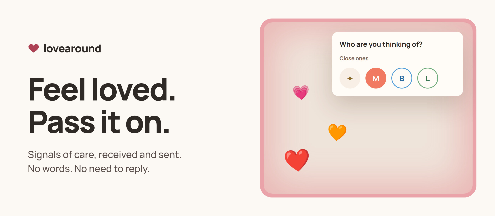

Someone thought of you. With **lovearound**, that reaches you as a soft glow on your screen, with no name, no words and no need to reply. And when you feel like it, one tap passes a little love on, to someone close or someone out there.

### Get the app

Free, and it stays out of your way in the menu bar or the system tray.

[macOS 13+](https://lovearound.me/download/LoveAround.dmg) · [Windows 10 and 11](https://lovearound.me/download/LoveAroundSetup.exe) · [Ubuntu 24.04+ (preview)](https://lovearound.me/download/LoveAround.deb)

### Repositories

| | |
|---|---|
| [**mac**](https://github.com/lovearound-me/mac) | The menu bar app, in Swift |
| [**windows**](https://github.com/lovearound-me/windows) | The tray app, with Tauri 2 and Rust |
| [**linux**](https://github.com/lovearound-me/linux) | The tray app, with Python and GTK 3, plus a GNOME Shell extension |
| [**site**](https://github.com/lovearound-me/site) | [lovearound.me](https://lovearound.me) in 13 languages, with the API docs |
